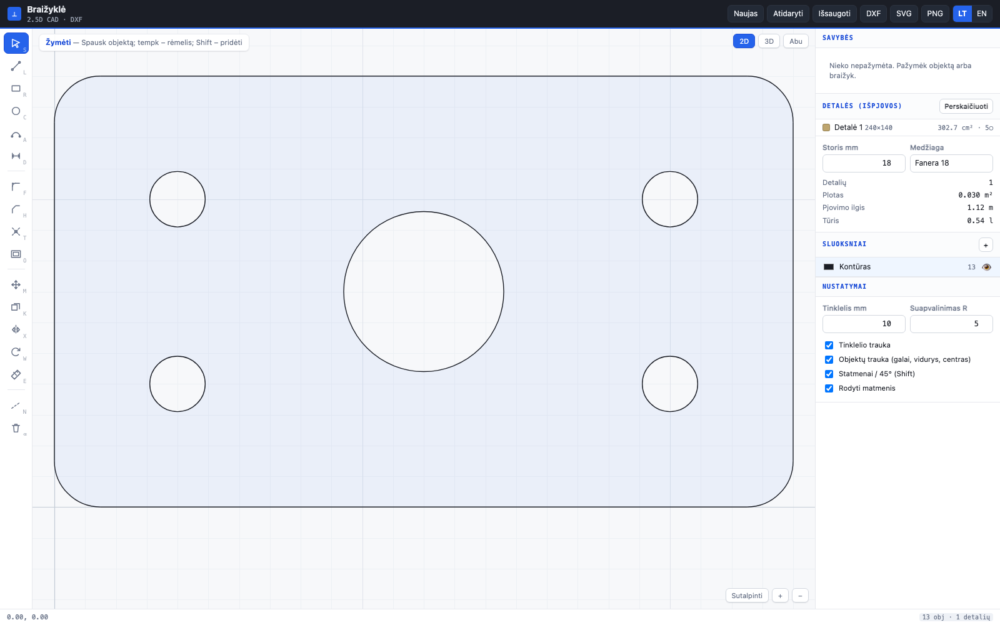

# Braižyklė — 2.5D CAD in a browser tab

**Draw an outline, give it a thickness, export DXF to the router.** No install, no licence,
no sign-up. One HTML file.



> 🇱🇹 Lietuviškas aprašymas: [README.lt.md](README.lt.md) · The app's UI has an LT/EN toggle.

## Why this exists

I needed to draw one-off parts for CNC routing — a panel with a few holes, a curved front,
a jig. The commercial CAD we had was overkill for that, and the capable free options are
licensed for **non-commercial use only**, which a working shop can't use.

So this does exactly the slice I needed: precise 2D geometry in, a DXF the CAM software
accepts out.

## What it does

**Drawing** — line (chained), rectangle, circle, arc (centre → start → end), dimensions.
While drawing you can **type the numbers**: start typing a length, <kbd>Tab</kbd> for the
angle, <kbd>Enter</kbd> to place. <kbd>Shift</kbd> constrains to perpendicular / 45°.

**Snapping** — endpoints, midpoints, centres, quadrants, intersections, point-on-line and
grid. The status bar names whatever it just snapped to, so you're never guessing.

**Editing** — fillet, chamfer, trim against *real* computed intersections, offset with
sharp corners, move, copy, mirror, rotate, rectangular and polar arrays. Every line and
circle is also editable **numerically** in the properties panel (X1, Y1, length, angle, R, Ø).

**Parts** — closed loops are detected automatically and inner loops become holes. The app
reports area, perimeter, cut length and volume — and **flags open ends in red**, because an
unclosed contour is the thing CAM will reject after you've already walked to the machine.

**3D preview** — the contour is extruded to its thickness (per part), orbit with the mouse.
2D / 3D / split view.

**Export** — DXF R12 (LINE, ARC, CIRCLE + layer table, mm), SVG, PNG, project as JSON.
Construction lines and dimensions are deliberately **excluded** from the DXF so the CAM
software can't mistake them for geometry.

## The parts that were actually hard

- **Exact arc areas.** Shoelace over polyline approximations drifts, and the area feeds the
  material cost. Arc segments contribute their exact circular-segment area instead.
- **Consistent winding.** Outer loops are forced CCW and holes CW, so extrusion, area and
  DXF output all agree on what is solid and what is a hole.
- **Trim against true intersections**, not against rendered pixels — so trimming stays
  correct at any zoom.

## Draft v3.0 — DXF editor + viewer (`draft.html`)

A second tool in this repo: open an existing DXF/DWG (or a STEP/IGES/STL/OBJ model), edit it and save DXF again.
Live: <https://gervdalius-droid.github.io/cad/draft.html>

- **Edit** — move, copy, rotate, scale, mirror, stretch, offset, trim, chamfer, fillet (also replaces existing fillets; R0 = sharp corner), join/explode, grips, exact sizes in the panel.
- **Sheets with parts** — detects the sheet and every part (including parts nested in cutouts), drag parts with snapping, R rotate / F flip, overlap / off-sheet / gap warnings, auto-arrange.
- **Viewer** — distance/angle dimensions, holes by diameter, cut length, open-contour warning; 3D STEP/IGES/STL/OBJ with measuring and projection to DXF (straight into the 2D editor).

## Run it

```bash
python3 serve.py          # http://localhost:8752/
python3 serve.py 9000     # different port
```

Tests: <http://localhost:8752/test.html> — **72 checks** covering geometry, loop detection,
export and the UI itself. No runner to install; it's a page you open.

## Built with

Vanilla JavaScript, HTML Canvas, no dependencies, no build step. ~1,800 lines.
